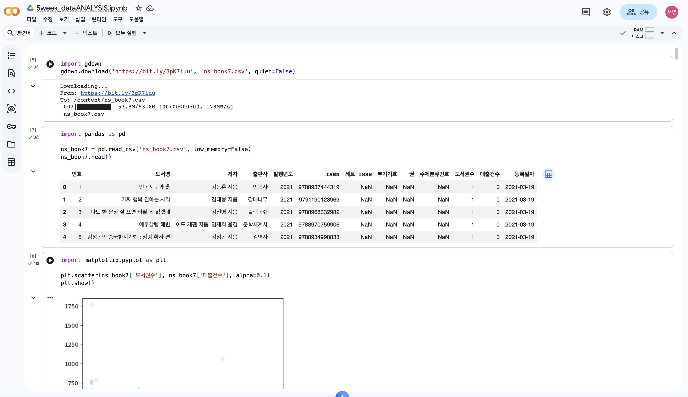
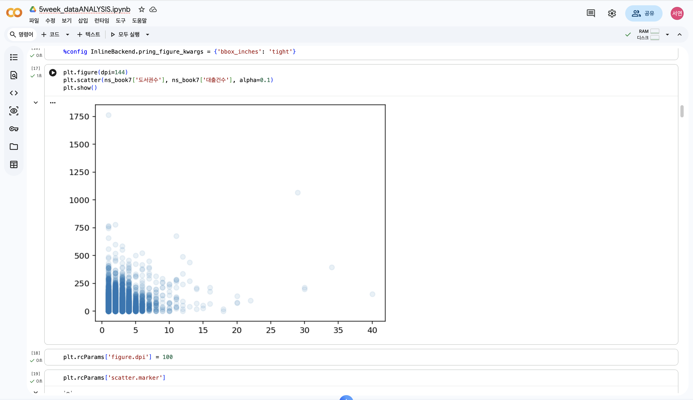
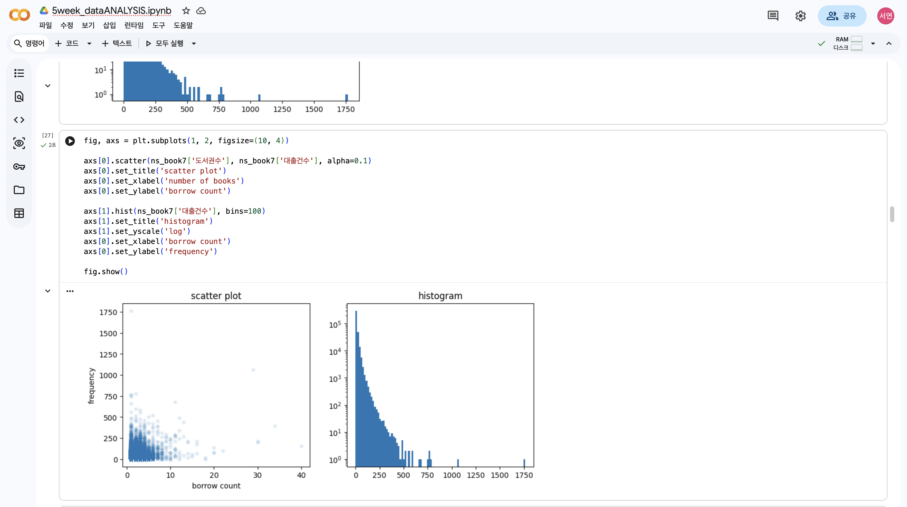
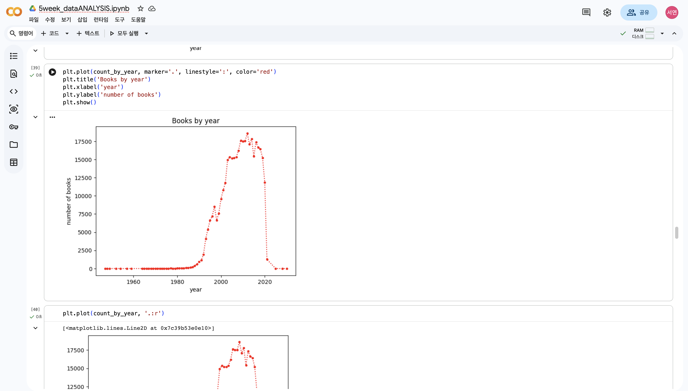
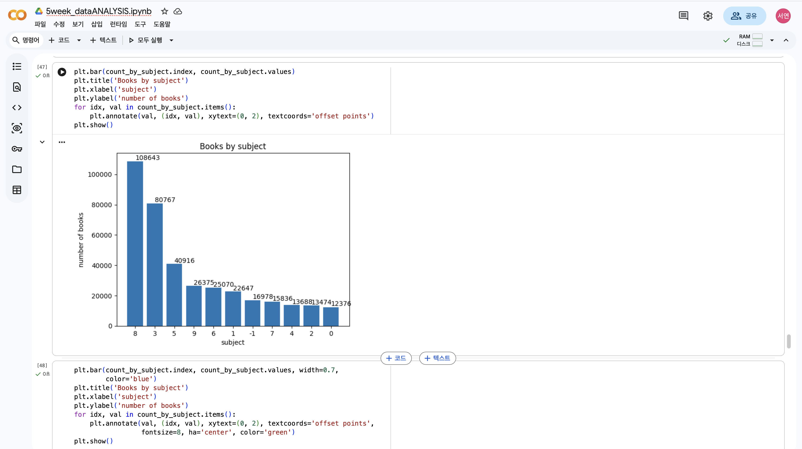
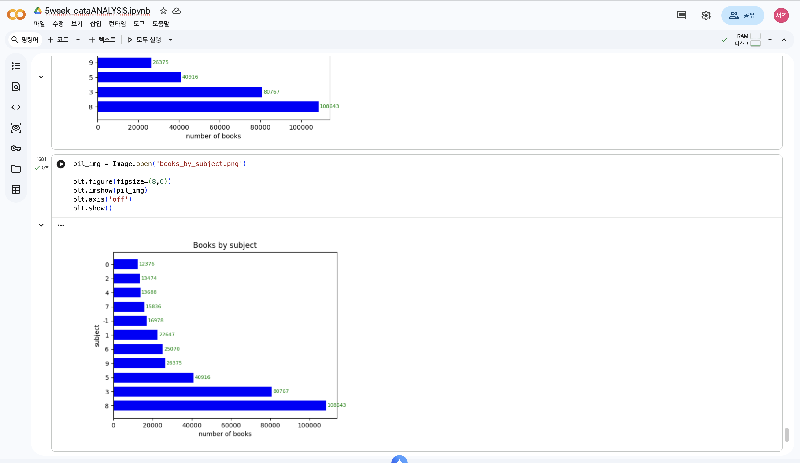

# 데이터분석 5주차 정규과제

📌데이터분석 정규과제는 매주 정해진 분량의 『*혼자 공부하는 데이터 분석 with 파이썬*』 을 읽고 학습하는 것입니다. 이번 주는 아래의 **DataAnalysis_5th_TIL**에 나열된 분량을 읽고 공부하시면 됩니다.

아래의 문제를 풀어보며 학습 내용을 점검하세요. 문제를 해결하는 과정에서 개념을 스스로 정리하고, 필요한 경우 제시된 강의를 참고하여 보완하는 것이 좋습니다.

<!-- 강의 링크는 아래와 같습니다.
https://www.youtube.com/watch?v=ho0LZ6GWhtc&list=PLVsNizTWUw7FGzSRCkQrPEEe-ljVXgS7k&index=10
https://www.youtube.com/watch?v=deYY4xHsI0o&list=PLVsNizTWUw7FGzSRCkQrPEEe-ljVXgS7k&index=11
-->


## DataAnalysis_5th_TIL

### 5장 데이터 시각화하기
#### 01. 맷플롯립 기본 요소 알아보기
#### 02. 선 그래프와 막대 그래프 그리기


## Study Schedule

| 주차  | 공부 범위     | 완료 여부 |
| ----- | ------------- | --------- |
| 1주차 | p.24~81    | ✅         |
| 2주차 | p.84~151   | ✅         |
| 3주차 | p.154~219  | ✅         |
| 4주차 | p.222~279 | ✅         |
| 5주차 | p.282~325 | ✅         |
| 6주차 | p.328~379 | 🍽️         |
| 7주차 | p.382~430 | 🍽️         |

<br>

<!-- 여기까진 그대로 둬 주세요-->


# 1️⃣ 개념 정리 

## 01. 맷플롯립 기본 요소 알아보기
### Figure 객체 
- 맷플롯립에서 모든 그래프 구성 요소를 담고 있는 최상위 객체
- 이 객체를 활용하면 다양한 그래프 옵션 조정 가능

#### 그래프 크기 바꾸기 : figsize 매개변수
- 그래프의 크기를 튜플로 지정 가능
  - 튜플 : 리스트와 비슷하게 생겼음. 소괄호()로 표현. 한 번 생성하면 삭제하거나 수정할 수 없음.
  - 단위는 인치
 
#### 그래프 실제 크기 확인
- DPI 확인 
  - DPI : dot per inch의 약자로 1인치를 몇 개의 점으로 표현하는지 나타냄. (인쇄 출력물의 해상도) 
  - (비교) PPI : pixel per inch의 약자. 1인치를 몇 개의 픽셀로 표현하는지 나타냄. (화면 해상도)
- bbox_inches 옵션 None으로 지정 : 코랩 노트북의 타이트 레이아웃을 사용하지 않는 경우

#### 그래프 크기 바꾸기 : dpi 매개변수 
- fig size 그래프를 그리는 캔버스 크기
- DPI : 그래프를 확대해서 보는 돋보기

---

### rcParams 객체 
- rcParams : 맷플롯립 그래프의 기본값을 관리하는 객체

#### DPI 기본값 바꾸기 
- 형식 : plt.rcParams['figure.dpi'] = (원하는 기본값)

#### 산점도 마커 모양 바꾸기 
- 산점도 그래프의 마커 기본값을 확인 : plt.rcParams['scatter.marker']
- 형식 : plt.rcParams['scatter.marker'] = (원하는 모양)
- 기본값 수정이 아닌 해당 그래프만 바로 수정하려면 marker 매개변수 사용.

---

### 여러 개의 서브플롯 출력하기 
- 서브플롯 : 맷플롯립의 Axes 클래스의 객체. 하나의 서브플롯은 두 개 이상의 축 포함.

#### 서브플롯 그리기 : subplots() 함수 
- 서브플롯 정의 : subplots() 함수에 원하는 서브 플롯 개수 지정
  - 서브플롯은 피겨 객체 안에 그려짐
- 피겨 객체와 각 서브플롯을 나타내는 Axes 객체의 배열을 반환
- fig size 매개변수 제공
  - fig size 매개변수 : 피겨의 크기를 조절하여 서브플롯 크기를 바꿀 수 있음. 
- set_title() 메서드 : 각 그래프 제목 지정

#### 서브플롯을 가로로 나란히 출력하기 
- subplots() 함수에 행과 열 지정 : 예 - subplots(1(행),2(열)
  
<!-- 새롭게 배운 내용을 자유롭게 정리해주세요.-->

## 02. 선 그래프와 막대 그래프 그리기
- 선 그래프 : 데이터 포인트 사이를 선으로 이은 그래프
- 막대 그래프 : 데이터 포인트 크기를 막대 높이로 나타내는 그래프

### 연도별 발행 도서 개수 구하기 
- value_counts() 메서드 : 고유한 값의 등장 횟수를 계산
- 인덱스 기주으로 정렬하고 싶은 경우 : sort_index() 메서드

---

### 주제별 도서 개수 구하기 
- 형식 :
  > import numpy as np # np.nan을 사용하기 위해 넘파이 임포트 
  > 
  >   def kdc_1st_char(no): # '주제분류번호' 열의 값이 NaN인 경우 -1 반환. else 첫 번째 문자 반환
  >   if no is np.nan:
  >      return '-1'
  >   else:
  >     return no[0]
  >
  > count_by_subject = ns_book7['주제분류번호'].apply(kdc_1st_char).value_counts()
  > count_by_subject

---

### 선 그래프 그리기
- 맷플롯립 plot() 함수 이용

#### 선 모양과 색상 바꾸기 
- linestyle 매개변수 : 선 모양 지정 가능
  - 실선 : '-'
  - 점선 : ':'
  - 쇄선 : '-.'
  - 파선 : '--'
- color 매개변수 : 16진수 컬러 코드 지정 / 색 이름 지정
- plot() 함수의 매개변수에 지정 마커, 선 모양, 색깔을 하나의 문자열로 합쳐서 선 그래프의 포맷으로 나타낼 수 있음
  - 예 : '.:r'

#### 선 그래프 눈금 개수 조절 및 마커에 텍스트 표시하기 
- sticks() 함수 : x축 눈금 지정
    - 틱 : 그래프의 눈금
  - range() 함수 : 연속된 숫자를 만들어주는 함수
  - 슬라이스 연산자(:) : 원하는 부분만 가져올 때 사용
  - items() 메서드 : 인덱스와 값을 감싼 튜플을 얻을 수 있음
- annotate() 함수 : 그래프 값 표시
  - xytext 매개변수 : 텍스트 위치 조절
  - textcoords 매개변수 : 상대적인 위치를 포인트나 픽셀 단위로 지정

---

### 막대 그래프 그리기 
- bar() 함수

#### 텍스트 정렬, 막대 조절 및 색상 바꾸기 
- annotate() 함수의 ha 매개변수 : 텍스트 위치 조절
  - fontsize 매개변수 : 텍스트 크기 조절
  - color 매개변수 : 텍스트 색깔 지정
- width 매개변수 : 막대의 두께 조절
- color 매개변수 : 색깔 지정

#### 가로 막대 그래프 그리기
- barh() 함수
- height 매개변수 : 막대의 두께 조절
- annotate() 함수에 텍스트 좌표를 쓸 때 x축과 y축이 바뀜
- va 매개변수 : 텍스트 정렬

---

### + 이미지 출력하고 저장하기 
#### 이미지 읽기 
- imread() 함수

#### 이미지 화면에 출력하기 
- imshow() 함수
- axis() 함수 off : 이미지에 표시된 축과 눈금 출력하지 않는 경우

#### 이미지 저장하기 
- imsave() 함수

### + 그래프를 이미지로 저장하기 
- save fig() 함수 

  
<!-- 새롭게 배운 내용을 자유롭게 정리해주세요.-->


# 2️⃣ 수행 인증

<!-- 교재에서 안내된 과정을 직접 실행해본 뒤, 진행 결과가 보이도록 4~6장의 스크린샷을 캡처하여 아래에 첨부해주세요.-->






<br>
<br>

# 3️⃣ 확인 문제

## 문제 1.

> **🧚Q. 다음 데이터를 이용하여 matplotlib으로 선그래프를 그리는 코드를 작성해주세요.**
- x = [1, 2, 3, 4, 5]
- y = [2, 4, 6, 8, 10]
> 조건은 아래와 같습니다.
```
1️⃣ 제목은 "Linear Trend"로 설정해주세요.
2️⃣ x축 이름은 "X values"로 설정해주세요.
3️⃣ y축 이름은 "Y values"로 설정해주세요.
4️⃣ 마커(marker)를 포함하여 선그래프를 그려주세요.
```

```
import matplotlib.pyplot as plt

plt.plot(x, y, marker='o')
plt.title("Linear Trend")
plt.xlabel("X values")
plt.ylabel("Y values")

plt.show() 
```


### 🎉 수고하셨습니다.
