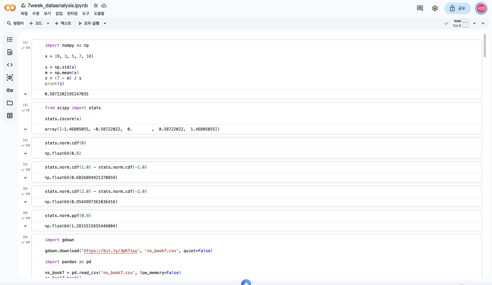
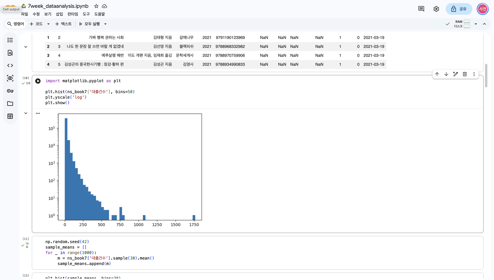
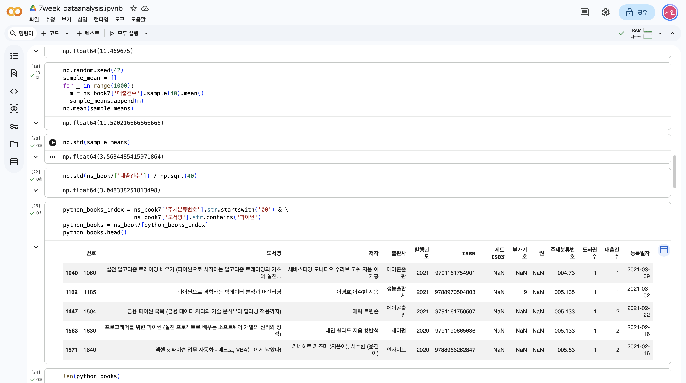
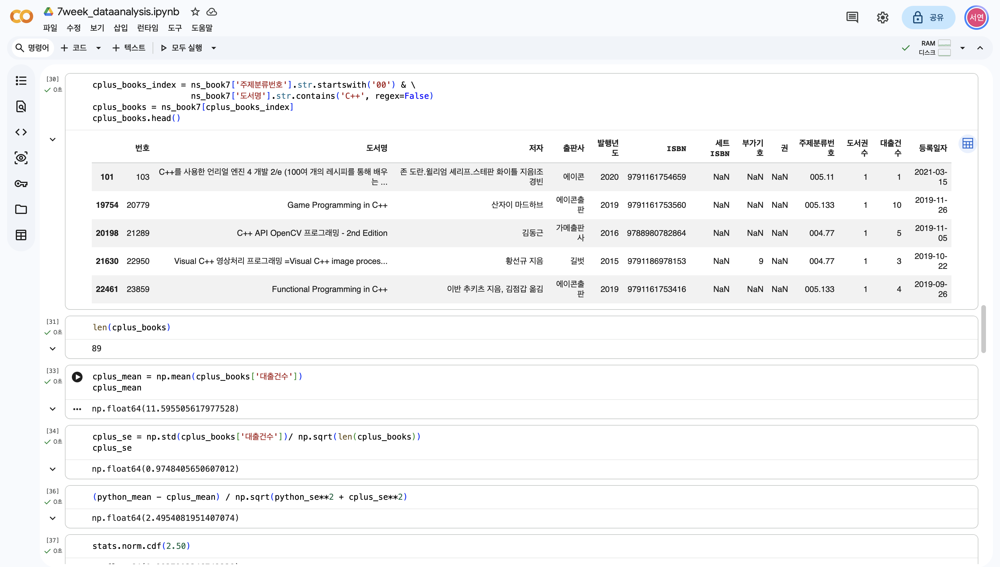
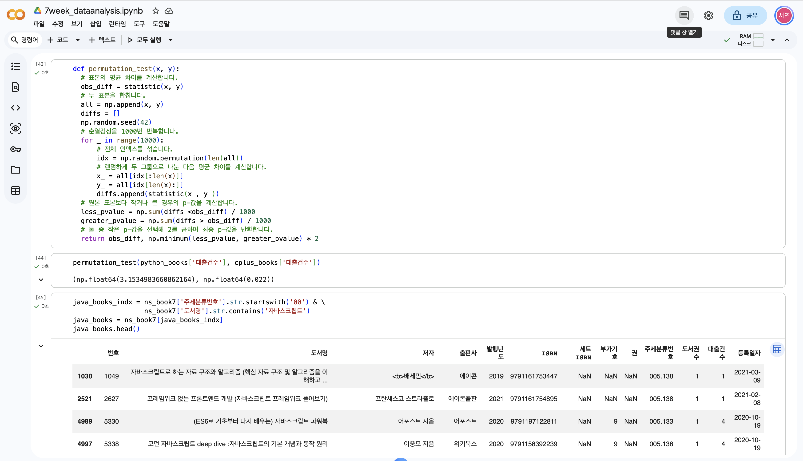
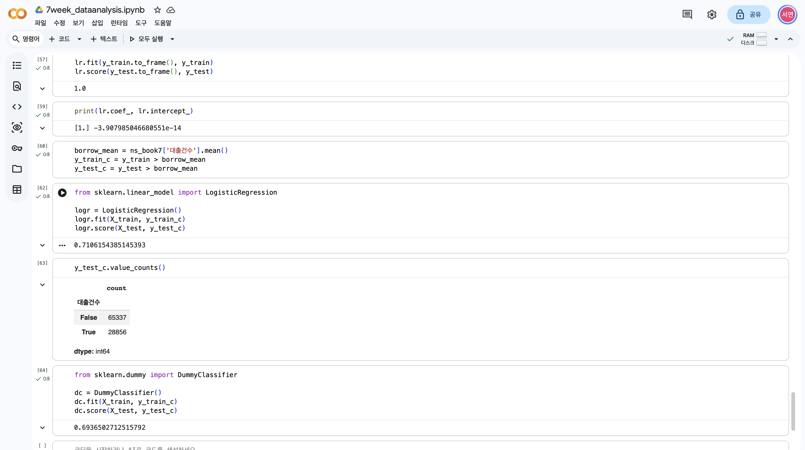

# 데이터분석 7주차 정규과제

📌데이터분석 정규과제는 매주 정해진 분량의 『*혼자 공부하는 데이터 분석 with 파이썬*』 을 읽고 학습하는 것입니다. 이번 주는 아래의 **DataAnalysis_7th_TIL**에 나열된 분량을 읽고 공부하시면 됩니다.

아래의 문제를 풀어보며 학습 내용을 점검하세요. 문제를 해결하는 과정에서 개념을 스스로 정리하고, 필요한 경우 제시된 강의를 참고하여 보완하는 것이 좋습니다.

<!-- 강의 링크는 아래와 같습니다.
https://www.youtube.com/watch?v=R3E4m8fqUSg&list=PLVsNizTWUw7FGzSRCkQrPEEe-ljVXgS7k&index=14
https://www.youtube.com/watch?v=W_cxRstQUk8&list=PLVsNizTWUw7FGzSRCkQrPEEe-ljVXgS7k&index=15
-->


## DataAnalysis_7th_TIL

### 7장 검증하고 예측하기
#### 01. 통계적으로 추론하기
#### 02. 머신러닝으로 예측하기


## Study Schedule

| 주차  | 공부 범위     | 완료 여부 |
| ----- | ------------- | --------- |
| 1주차 | p.24~81    | ✅         |
| 2주차 | p.84~151   | ✅         |
| 3주차 | p.154~219  | ✅         |
| 4주차 | p.222~279 | ✅         |
| 5주차 | p.282~325 | ✅         |
| 6주차 | p.328~379 | ✅         |
| 7주차 | p.382~430 | ✅         |

<br>

<!-- 여기까진 그대로 둬 주세요-->


# 1️⃣ 개념 정리 

## 01. 통계적으로 추론하기
### 모수검정이란
- 모수검정 : 모집단에 대한 파라미터를 추정하는 방법
  - 모집단 : 전체 데이터 
  - 표본 : 모집단에서 선택한 일부 샘플
- 모수검정은 모집단의 데이터에 대해 정규분포를 따른다고 가정. 
  - 정규분포 : 평균을 중심으로 대칭인 분포. 종모양 형태
---

### 표준점수 구하기
- 표준점수(z점수) : 데이터가 정규분포를 따른다고 가정하고, 각 값이 평균에서 얼마나 떨어져 있는지 표준편차를 사용해 변환한 점수
  - z = (x - 모집단의 평균) / 모집단의 표준편차
  - 표준편차 :분산의 제곱근으로 데이터의 분포 정도를 나타냄 -> 이를 점수화한 것으로 데이터 분포 가늠 가능.
#### z점수 구하기 
- z 점수 : 사이파이의 stats 모듈을 임포트한 다음 zscore() 함수를 호출하여 계산 가능 
#### 누적분포 이해하기 
- 표준정규분포 : 평균 0, 표준편차 1인 정규분포
#### 누적분포 구하기 
- 사이파이의 norm.cdf() 메서드 : z 점수로 누적분포를 구할 수 있음. 
- 사이파이의 norm.ppf() 메서드 : 누적분포로 z 점수를 구할 수 있음.
---

### 중심극한정리 알아보기 
- 중심극한정리 : 무작위로 샘플을 뽑아 만든 표본의 평균은 정규분포에 가깝다.
#### 샘플링하기 
- 판다스 데이터프레임의 sample() 메서드 : 무작위 샘플링
#### 샘플링 크기와 정확도 
- 정규분포 형태의 평균이 모집단의 평균과 매우 가까움.
- 표본 평균의 표준편차가 모집단의 표준편차를 표본 크기의 제곱근으로 나눈 것에 가까움.
- 표준오차 : 표본 평균의 표준편차
---

### 모집단의 평균 범위 추정하기 : 신뢰구간 
- 신뢰구간 : 표본의 파라미터가 속할 것이라 믿는 모집단의 파라미터 범위
---

### 통계적 의미 확인하기 : 가설검정
- 가설검정 : 표본에 대한 정보를 사용해 모집단의 파라미터에 대한 가정을 검정하는 것
- 영가설(귀무가설) : 표본 사이에 통계적으로 의미가 없다고 에상되는 가설
- 대립가설 : 표본 사이에 통계적인 차이가 있다는 가설
- 유의수준 : 영가설을 기각할지 말지에 대한 z 점수에 대한 기준.
- p-값 : 정규분포의 양쪽 꼬리 면적을 더해 5%가 되는 지점. p-값이 0.05미만일 떄 영가설을 기각
##### z점수로 가설 검증하기 
- 평균 계산 -> 표준오차 계산 -> 가설검정 공식에 대입 -> 누적분포 확인
##### t-검정으로 가설 검증하기 
- ttest_ind() 함수 : t-분포인 두 표본을 비교하는 t-검정 수행
- t-분포 : 정규분포와 비슷. 중앙은 조금 더 낮고 꼬리가 더 두꺼운 분포.
  - 표본의 크기 <= 30 : t-분포를 사용하는 것이 좋음.
  - 표본 크기가 > 30 :  t-분포는 정규분포와 매우 비슷해짐.
- z점수나 t-검정으로 p-값을 구하여 가설을 검증할 때는 모집단이 정규분포의 형태를 따른다고 가정하여 수행 
---

### 정규분포가 아닐 때 가설 검증하기 : 순열검정 
- 순열검정 : 모집단의 분포가 정규분포를 따르지 않거나 모집단의 분포를 알 수 없을 때 사용할 수 있는 방법
  - 비모수검정 방법 중 하나 
- 순열검정의 방법 : 두 표본의 평균 차이 계산 -> 표본을 섞고 무작위로 두 그룹 나누기 -> 두 그룹을 표본의 크기 동일하게 만들기 -> 다시 평균 차이 계산 -> 이 과정을 여러 번 반복하여 p-값 계산 
#### 도서 대출건수 평균 비교하기
- 파이썬
  - statistic() 함수 : 두 개의 배열을 받아 평균 구하기
  - permutation_test() 함수 : 두 배열을 넘파이 append() 함수로 합친 후 무작위로 추출하기 위해 사용. 무작위로 섞인 배열을 만듦.


<!-- 새롭게 배운 내용을 자유롭게 정리해주세요.-->

## 02. 머신러닝으로 예측하기
### 알아 두면 좋은 머신러닝 용어 
- 머신러닝 : 컴퓨터 프로그램을 사용해 데이터에서 패턴을 학습하는 용어
  - 인공지능의 하위 분야
  - 지도 학습과 비지도 학습으로 나뉨.
#### 모델 
- 모델 : 때에 따라 추상적으로 또는 구체적으로 사용됨.
  - 선형 회귀 모델에서의 모델 : 머신러닝으로 학습된 패턴을 저장하는 소프트웨어 객체
#### 지도 학습과 비지도 학습 
- 지도 학습 : 데이터에 있는 각 샘플에 대한 정답을 알고 있는 경우
  - 타깃 : 정답 
  - 입력 : 타깃을 맞추기 위해 모델이 재료로 사용하는 데이터
  - 훈련 : 머신러닝 모델에 입력과 타깃을 전달하여 데이터에 있는 패턴을 학습 시키는 과정
  - 예 : 선형 회귀 알고리즘 
- 비지도 학습 : 입력 데이터는 있지만 타깃은 없는 경우
  - 정답 데이터를 모으기 매우 어렵거나 비용이 많이 드는 경우 사용.
  - 예 : 군집 알고리즘
---

### 모델 훈련하기 
- 훈련 세트 : 모델 훈련하기 위한 입력, 타깃
- 테스트 테스트 : 모델을 평가하기 위한 입력, 타깃
#### 훈련 세트와 테스트 세트로 나누기 
- 데이터를 무작위로 섞은 후 샘플을 훈련 세트와 테스트 세트로 나누어야 함.
- train_test_split() 함수 : 기본적으로 입력된 데이터를 무작위로 섞은 후 75%를 훈련 세트로 25%를 테스트 세트로 나눔.
- 특성 : 2차원 배열인 입력은 행 방향으로 샘플이 나열되고 열 방향으로 나열된 샘플의 속성
#### 선형 회귀 모델 훈련하기 
- LinearRegression 클래스 : 선형 회귀 알고리즘
- 이 클래스의 객체 Ir을 만들고 객체의 fix() 메서드를 호출하여 모델을 훈련
---

### 훈련된 모델을 평가하기 : 결정계수
- score() 메서드 : 훈련된 머신러닝 모델이 얼마나 유용한지를 평가
- 결정계수 : score() 메서드가 반환하는 점수
  - 1에 가까울수록 관게가 깊다고 볼 수 있음.
---

### 연속적인 값 예측하기 : 선형 회귀 
- 선형 회귀 : 선형 함수를 사용해 모델을 만드는 알고리즘
- 선형 회귀 알고리즘 : 입력에 기울기를 곱하고 y축과 만나는 절편을 더하여 예측을 만나는 것
- 회귀 : 지도 학습 중에서 타깃이 실수인 문제 
---

### 카테고리 예측하기 : 로지스틱 회귀 
- 타깃이 실수가 아니라 어떤 종류의 카테고리인 경우
- 이진분류 : 두 개의 카테고리로 구분하는 경우
  - 0 : 음성 클래스
  - 1 : 양성 클래스 
- 다중 분류 : 세 개 이상의 카테고리로 구분하는 경우
- 클래스 : 분류 알고리즘에서의 타깃 카테고리
- 로지스틱 회귀 : 연속적인 실수 출력값을 1 또는 0으로 변환.
  - 시그모이드 함수
#### 로지스틱 회귀 모델 훈련하기 
- 정확도 : 사이킷런의 분류 모델의 경우 score() 메서드가 출력하는 점수. 입력 데이터 중 정답을 맞힌 비율/
  - score() 메서드의 출력 결과는 선형 회귀 모델에서는 결정계수, 분류 모델에서는 정확도.
#### 양성 클래스와 음성 클래스 분포 확인하기 
- 더미 모델 : 사이킷런에서 가장 많은 클래스로 무조건 예측을 수행
  - 회귀일 경우 DummyRegressor 모델 존재 -> 무조건 타깃의 평균을 에측
  - 분류일 경우 DummyClassifier 모델이 기본적으로 가장 많은 클래스를 예측으로 출력 
    


<!-- 새롭게 배운 내용을 자유롭게 정리해주세요.-->


# 2️⃣ 수행 인증

<!-- 교재에서 안내된 과정을 직접 실행해본 뒤, 진행 결과가 보이도록 4~6장의 스크린샷을 캡처하여 아래에 첨부해주세요.-->







<br>
<br>

# 3️⃣ 확인 문제

## 문제 1.

> **🧚Q. 어떤 표본의 크기가 충분히 크고(n ≥ 30), 모집단 분산을 알 수 없을 때 모평균에 대한 신뢰구간을 구하려고 한다.
이때 다음 설명 중 가장 적절한 것은 무엇인가?**

```
1️⃣ 표본의 크기가 충분히 크므로 중심극한정리에 의해 표본평균의 분포는 근사적으로 정규분포를 따른다.  
2️⃣ 모집단 분산을 모르므로 신뢰구간을 구할 수 없다.  
3️⃣ 표본이 30개 이상이면 항상 모집단도 정규분포를 따른다.  
4️⃣ 중심극한정리는 모집단이 정규분포일 때만 적용된다.
```

```
1번
```

## 문제 2.

> **🧚Q. 다음 중 순열검정(permutation test)에 대한 설명으로 가장 옳은 것은 무엇인가?**

```
1️⃣ 모집단이 정규분포를 따른다는 가정을 반드시 해야 한다.  
2️⃣ 표준점수(z-score)를 이용하여 유의확률을 계산하는 방법이다.  
3️⃣ 데이터의 라벨을 무작위로 섞어 귀무가설 하에서의 분포를 직접 구성하는 비모수적 검정 방법이다.  
4️⃣ 표본의 크기가 충분히 클 때만 사용할 수 있다.
```

```
3번
```


### 🎉 수고하셨습니다.
